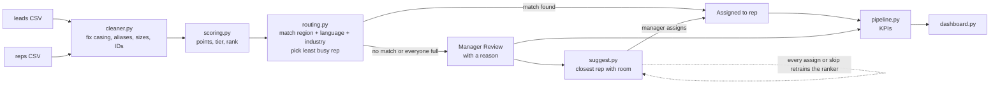

# Lead Router

Prioritises sales leads and routes them to the right rep (Salesforce Ignite Challenge).

Cleaning, scoring, routing and the dashboard all work. Keep adding to this as we finish stuff.

## How data flows through it



Everything stays in memory. Nothing gets written to a database, and each run reloads the reps so their load starts fresh.

## Setup

```
python3 -m venv .venv
source .venv/bin/activate
python -m pip install -r requirements.txt
```

Put the four CSVs (`leads_sample.csv`, `reps_sample.csv`, `leads_scale.csv`, `reps_scale.csv`) in `data/`.

## Run the dashboard

```
streamlit run dashboard.py
```

Hit Run Scale for the real demo. The sample only has 10 reps, so most of its leads end up in Manager Review.

What's on it:

- **Buttons:** Run Sample, Run Scale and Reset.
- **Top line:** how many leads, how long it took, how many got assigned vs sent to review, % of Critical leads assigned, capacity used and how many reps are maxed out.
- **Leads by priority chart** split into assigned vs review, plus a table of why leads went to review.
- **Lead Queue:** filter by priority, region and status, search by company, lead ID or rep. Click any column header to sort.
- **Manager Review:** only the unassigned leads, best first, each with its reason and a suggested rep. Pick rows and assign or skip them, accept the top N, or accept all of them. The KPIs update right away. Filter by priority and download it as a CSV.
- **Rep Capacity:** load by seniority chart and a load bar for every rep, busiest first. Filter by seniority and by full / has room / no capacity.

## Use it from Python

```python
from leadrouter.pipeline import run, summary

leads, reps, seconds = run("scale")
print(summary(leads, reps))
```

## Run the tests

```
python -m pytest
```

## Cleaning rules (summary)

Quick rundown of how we clean up the lead data:

- **Save everything:** We don't throw anything away. If a field is bad or missing, we just swap it for None or a safe default and keep the record moving.

- **Tidy up text:** Things like region, language, and seniority get lowercased, stripped of weird punctuation, and matched against our alias table. If a record lists two regions (like "North America Asia-Pacific"), we keep both.

- **Company size:** We handle all sorts of formats, like 1,000, 5k, or ranges like 500-1000 (which we average out). Any zero, negative, or garbled numbers just get marked as missing.

- **VIP status:** Only an explicit True counts for VIP_Referral. Anything blank or unknown defaults to False.

- **Handling duplicates:** If two leads share the same Lead_ID, we assume they're different companies and keep both, just renaming the later ones to something like L-123#2. If an ID is totally missing, we assign it LEAD-ROW-<n>.

- **Rep capacity:** If a rep's capacity looks negative or unreadable, we treat it as zero. If we don't know a rep's seniority, we default them to Junior so they never get assigned Critical leads by mistake.

## Scoring

Every lead gets 0 to 100 points:

- **Company size:** 1000+ employees is 50, 100 to 999 is 30, under 100 is 0, and unknown gets 20.
- **Activity:** live demo or contact sales is 35, webinar 25, whitepaper 15, pricing page 5.
- **Industry:** Technology 20, Healthcare and Finance 15.
- **VIP referrals** skip all that and get 100.

Tiers: 90+ Critical, 70+ High, 40+ Medium, everything else Low. The cheat sheet uses 85/60/40 with smaller industry points, but that made about half the leads Critical, way more than the Senior reps can cover. Our numbers land close to the 10/20/40/30 split it asks for.

## Routing

- Leads go out highest score first, so Critical leads get first pick of the reps.
- A rep has to match the lead's region, language and industry. A lead with no industry can go to a generalist.
- Critical leads go to a Senior, or a Manager if every matching Senior is full. Never a Junior.
- Everything else goes to Juniors and Seniors. Managers are pricey, so we keep them free for Critical leads.
- Out of the reps who qualify, the least busy one (as a % of their max) gets it. Ties go to whoever got a lead longest ago.
- If nobody can take it, it goes to Manager Review with the reason why.

On the 50k file: 89.7% assigned, every Critical lead assigned, 95% of rep capacity used, under 1.5 seconds.

## Manager Review suggestions (the ML part)

On the 50k file 5,126 leads end up in review, all because every rep who matches them exactly is full. Meanwhile about 2,400 rep slots are still open, they're just with reps in a different industry or with Managers we kept free.

So every lead in review gets a suggested rep. Region and language still have to match, Critical leads still never go to a Junior, but the industry can be different. The manager decides, the router never does this on its own.

Suggestions are ranked by a logistic regression (scikit-learn) on four signals:

- same industry as the lead or not
- how much free room the rep has
- is the rep a Manager
- Manager on a high score lead (a Manager is more ok for a 70 than a 40)

There's no conversion data in the files, so there's nothing honest to train a lead scoring model on. Instead every Assign is a "yes, good suggestion" and every Skip is a "no". Until there are 10 decisions with at least one of each it uses our starting weights, after that it retrains on every click. The dashboard shows the starting weights next to the learned ones so you can see what changed.
